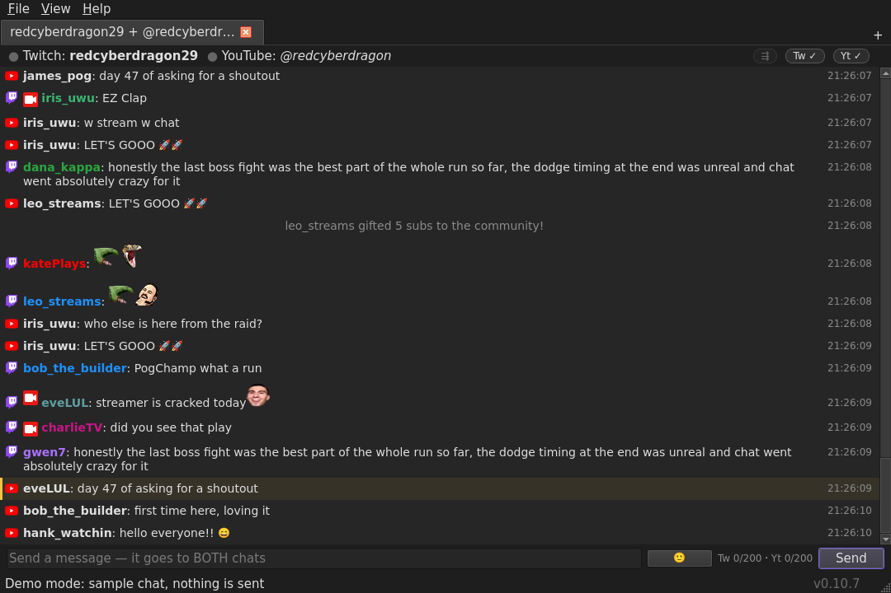
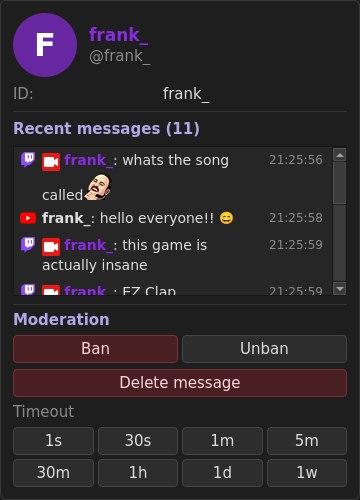

# ChatterSyn

A desktop chat client for streamers and mods who use **Twitch and YouTube at
the same time**: both live chats in one feed, and one input box that posts to
both.



## Features

- **One feed, one input.** Twitch and YouTube chat side by side in each tab;
  Enter sends to both (per-platform toggles, character counters, rate limits).
- **Stream tab.** Follows your own channel and joins your YouTube live chat as
  soon as you go live.
- **Emotes.** Twitch, 7TV, BTTV and FFZ, animated, with a picker and
  autocomplete.
- **User cards.** Click a name for account details, recent messages and, where
  you're a mod, ban, timeout and delete buttons.
- **Moderation commands.** `/ban`, `/timeout`, `/slow`, `/vip`, `/mod`,
  `/announce`, `/raid`, `/shoutout`, `/mods`, `/vips` and more, with
  suggestions as you type `/`.
- **Also:** highlights and mentions, Ctrl+F search, live status and uptime,
  chat logs, custom commands, hotkeys, dark and light themes.



## Install

**macOS** (Apple Silicon, macOS 14.4+):

```sh
brew tap smitht06/chattersyn
brew trust smitht06/chattersyn
brew install --cask chattersyn
```

**Linux** (Ubuntu, Debian, Mint): add the APT repository once, and
`apt upgrade` keeps ChatterSyn up to date.

```sh
curl -fsSL https://chattersyn-apt.pages.dev/chattersyn.gpg \
  | sudo gpg --dearmor -o /usr/share/keyrings/chattersyn.gpg
echo "deb [signed-by=/usr/share/keyrings/chattersyn.gpg] https://chattersyn-apt.pages.dev stable main" \
  | sudo tee /etc/apt/sources.list.d/chattersyn.list
sudo apt update && sudo apt install chattersyn
```

**Any Linux (Flatpak)**: download `chattersyn-<version>-linux-x86_64.flatpak`
from [Releases](https://github.com/smitht06/red-chattersyn/releases), then
`flatpak install --user <file>`.

**Windows**: download `chattersyn-<version>-windows-x86_64.zip` from
[Releases](https://github.com/smitht06/red-chattersyn/releases), unzip it and
run `chattersyn.exe`. On first launch SmartScreen may warn you: More info → Run
anyway.

**From source** (Python 3.11–3.13 and [uv](https://docs.astral.sh/uv/)):
`uv tool install .`, then `chattersyn`. Add `--demo` to try it with a fake
chat and no accounts.

## Sign in

Twitch chat works without an account. To send, see badges and live status, and
moderate, open **Settings → Accounts** (Ctrl+, / Cmd+,):

- **Twitch:** Connect Account… under Twitch, and approve in your browser.
- **YouTube:** Connect Account… under YouTube, and approve in your browser. While Google
  reviews ChatterSyn, Google shows "Google hasn't verified this app": click
  **Advanced**, then **Go to ChatterSyn**.

Your sign-ins are stored in the system keychain, never in the settings file.
Using your own Twitch or Google app, or a YouTube API key, is covered in
[Advanced setup](docs/advanced-setup.md).

## Settings and files

Settings live in `settings.json` (macOS: `~/Library/Preferences/ChatterSyn/chattersyn/`).
Chat logs are one file per channel per day in `logs/` next to it; YouTube logs
are deleted after 30 days, as YouTube's rules require. Settings → About opens
the diagnostic log.

## Development

```sh
uv sync
uv run chattersyn --demo
uv run ruff check src/ tests/ && uv run pytest -q
```

Releasing: [docs/releasing.md](docs/releasing.md).

<!-- release-notes:start -->
## Latest release: v0.10.7 (2026-11-10)

### Fixed
- **Your own messages in Twitch chat.** When a mod deleted one of your messages or timed you out, your own rows didn't grey out; deleting your own message (right-click or /delete) and replying to it used the wrong message. Your messages now carry Twitch's real message id, so all of these work.

Older releases and downloads: [GitHub Releases](https://github.com/smitht06/red-chattersyn/releases).
<!-- release-notes:end -->
